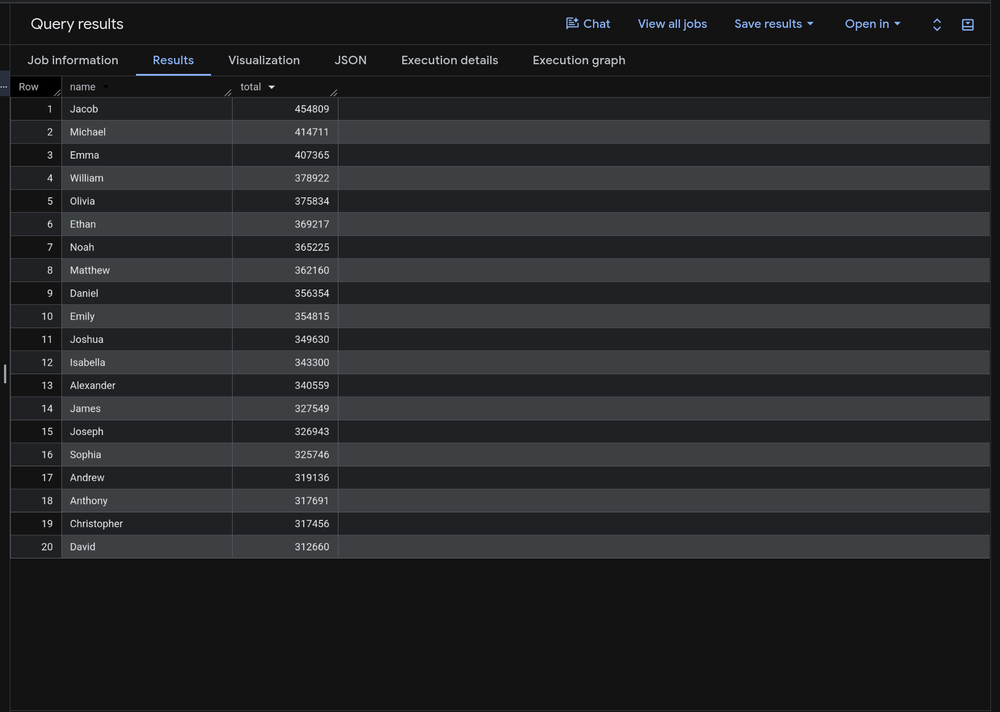
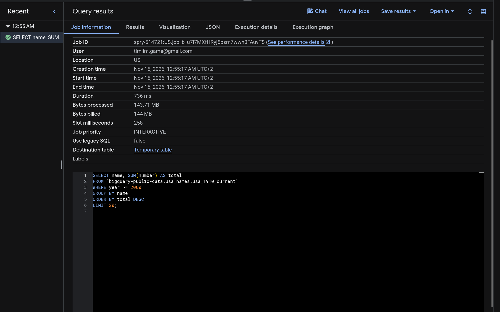
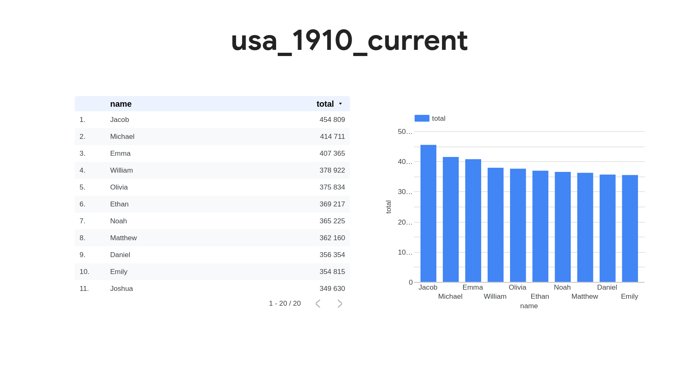
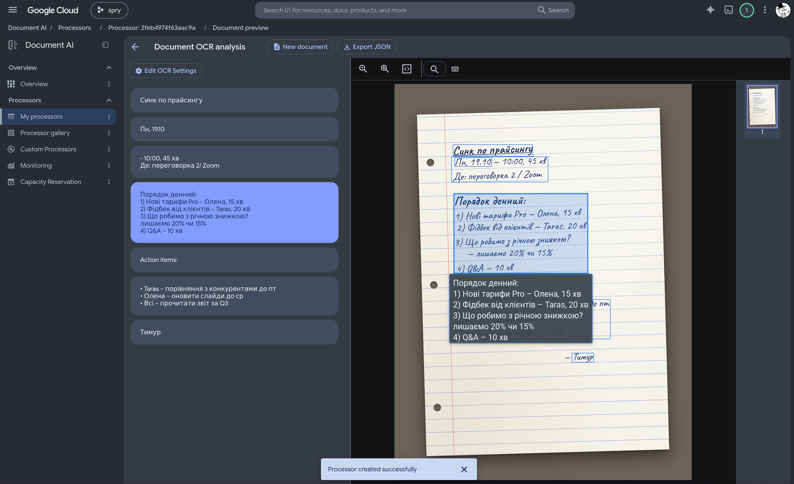

# Google Cloud Lab: Answers

Service choices: [ADR 0008](adr/0008-google-cloud.md). How to deploy: [README](../README.md#google-cloud).

## Submission

| Item | Where |
|---|---|
| `gcp/` Terraform + ADR | [PR #1](https://github.com/timlim24/NewProject/pull/1), merged as `f07495e`: `gcp/`, `gcp/bootstrap/`, `docs/adr/0008-google-cloud.md` |
| Running on Google Cloud | Frontend: https://spry-514721.web.app. API call that reads the database: https://spry-514721.web.app/api/health runs `SELECT 1` on Cloud SQL and returns `{"status":"ok"}`. Signed in, the meetings list comes from `GET /api/meetings` on Cloud SQL. Sign-in itself is Cognito on AWS |
| Cost table | [Part 3](#part-3-the-minimal-setup-on-both-clouds-and-what-it-costs) below |
| Screenshots | [Part 4](#demos): BigQuery query and bytes processed, Looker Studio chart, Document AI OCR result |

## Part 0: Project and identities

- Project `spry-514721` in organization `timlim-game-org`, region `us-central1`, Free Trial
  ($300, ends 13 February 2027), $5/month budget alert (50/90/100%).
- The organization is newer than May 2024, so Google's security baseline is enforced. Two
  constraints shaped the design:
  - `iam.managed.disableServiceAccountKeyCreation`: no keys can be created at all, so
    federation is the only way in for automation.
  - `iam.allowedPolicyMemberDomains`: `allUsers` cannot appear in IAM policies. The API is
    public through Cloud Run's `invoker_iam_disabled` instead of an `allUsers` invoker
    binding.
- `gcp/bootstrap/` (applied once by the project owner with `gcloud auth application-default login`):
  - Service account `terraform` with Cloud Run Admin, Cloud SQL Admin, Artifact Registry
    Administrator, Secret Manager Admin and Service Usage Admin. It holds Service Account User
    on the API's account only, not on the whole project.
  - Service account `new-project-api` with Cloud SQL Client. Cloud Run runs as this account,
    not the default compute account, which has Editor.
  - Workload identity pool `external-ci`, with two providers:
    - `hcp-terraform`: the condition admits our HCP organisation and workspace by ID.
    - `github`: the condition admits repository ID `1392415614` and owner ID `157886626`.
    Each provider can impersonate only its own service account.
- No service account key was created.

## Part 2: What was moved, and how the data got there

- **Database:** I ran the migrations against the empty database: the container runs
  `alembic upgrade head` on start, under an advisory lock. There was no `pg_dump` from Aurora.
  Aurora sits in private subnets with no public access, and the lab data is recreated through
  the app. The connection was tested locally before deploying: the Cloud Run image
  (`--target app`, `PORT=8080`) ran against PostgreSQL 17 through a Unix socket mounted at
  `/cloudsql/<project>:<region>:<instance>`. Migrations created all five tables,
  `/api/health` returned 200, unauthenticated `/api/meetings` returned 401, and `/events`
  returned 404.
- **Removed for Cloud Run:** the Lambda Web Adapter (now only in the `lambda` build stage) and
  the `/events` route (registered only on Lambda). The port comes from `$PORT`.
- **Still on AWS:** Cognito sign-in, the weekly report, and the agenda parser.

## Part 3: The minimal setup on both clouds, and what it costs

### Assumptions
- On-demand list prices in USD: AWS us-east-1, GCP us-central1, 730 h/month, no tax. GCP prices
  are those given in the lab.
- AWS core as in Lab 4 Stage 2. Aurora Serverless v2 at **$0.12 per ACU-hour**, running at
  **0.5 ACU while awake**, plus 5 minutes awake after the last query (`SecondsUntilAutoPause` 300).
  ~1 GB storage at $0.10. Registry, SSM and logs ≈ $0.20.
- GCP core as built: Cloud SQL `db-f1-micro` ($0.0105/h) with 10 GB SSD ($1.70). Cloud Run with
  request-based billing, 1 vCPU / 512 MiB, max 2 instances. Firebase Hosting free plan. One
  secret (free). Artifact Registry: the image is ~190 MB compressed and versions share base
  layers, so 3 kept images stay at about the 0.5 GB free tier.
- Traffic per request: ~100 ms of CPU. A list screen reads ~20 rows (or Firestore documents).
- **Unverified line:** the Cloud SQL public IPv4 address. Third-party pricing summaries and a
  Google Cloud forum reply say an address on a *stopped* instance bills about **$0.01/h**
  (~$7.30/month). The lab's "$1.70 stopped" figure leaves it out. I could not confirm it on
  Google's pricing page, so the stopped-instance columns show both numbers. Check the
  *Cloud SQL: IP address* SKU in Billing → Reports a day after stopping the instance.

### My project, nobody using it for a month

| Piece | AWS (Lab 4, Stage 2) | Google Cloud (this lab) |
|---|---|---|
| Frontend + CDN + HTTPS | CloudFront Free plan, WAF included → $0 | Firebase Hosting free plan → $0 |
| API | Lambda, idle → $0 | Cloud Run, scaled to zero → $0 |
| Database compute | Aurora, paused → $0 | Cloud SQL `db-f1-micro` running → $7.67 |
| Database storage | ~1 GB × $0.10 → $0.10 | 10 GB SSD × $0.17 → $1.70 |
| Registry, secrets, logs | ≈ $0.20 | within the free tier → $0 |
| **Total** | **≈ $0.30** | **≈ $9.37**. Stopped: $1.70 (≈ $9.00 if the idle IP bills) |

### The four traffic profiles

Monthly cost in USD:

| Profile | DB hours awake | AWS (Aurora) | GCP, Cloud SQL 24/7 | GCP, Cloud SQL stopped when unused | GCP, Firestore |
|---|---|---|---|---|---|
| Nobody | 0 | **0.30** | 9.37 | 1.70 (9.00) | **0.00** |
| Class demos, 10 × 2 h | ~21 (20 h + 10 × 5 min) | **1.55** | 9.37 | 1.91 (9.01) | **0.00** |
| Office hours, 8 h × 22 days | ~178 | 10.97 | 9.37 | **3.55** (9.09) | **0.00** |
| Busy around the clock, ~1 req/s ≈ 2.6 M req/month | 730 | 45.40 | **11.61** | same as 24/7 | 17.39 |

How the lines were computed:
- **AWS Aurora:** awake hours × 0.5 ACU × $0.12, plus $0.30 base.
  - Office hours: 177.8 h × $0.06 = $10.67.
  - Busy: 730 h × $0.06 = $43.80, plus Lambda (1.6 M billable requests × $0.20/M = $0.32) and
    Aurora I/O ≈ $1.
  - At 1 ACU, busy is ≈ $89.
- **Cloud SQL stopped when unused:** running hours × $0.0105 + $1.70.
  - Class demos: 20 h → $0.21.
  - Office hours: 176 h → $1.85.
  - In brackets: plus 554–710 idle hours × $0.01 for the IP.
- **Cloud Run, busy profile:**
  - Requests: 2.6 M − 2 M free = 0.6 M × $0.40/M = $0.24.
  - CPU: active time ≈ 2.6 M × 0.1 s = 260 k vCPU-s; minus 180 k free = 80 k × $0.000024 = $1.92.
  - Memory: within the 360 k GiB-s free tier.
  - Total ≈ $2.24. The other profiles fit in the free tier.
- **Firestore, busy profile:** 2.6 M requests × 20 reads = 52 M reads.
  - Minus 1.5 M free reads a month = 50.5 M × $0.03/100 k = $15.15.
  - Plus Cloud Run $2.24.
  - The other profiles stay under 50,000 reads a day.

### Which cloud is cheaper, and which single line decides it
The **database compute line** decides every profile; nothing else is more than a few cents
until the busy profile.
- **Nobody and class demos: AWS.** Aurora pauses, so idle hours cost $0, while Cloud SQL bills
  every hour it runs. On GCP only Firestore matches it, at the price of rewriting the data layer.
- **Office hours: about even, and it depends on the IP line.**
  - Cloud SQL 24/7 ($9.37) already beats Aurora awake 178 h at 0.5 ACU ($10.97).
  - Stopping Cloud SQL at night drops GCP to $3.55, but only if a stopped instance's IP is free.
    If it is not, stopping saves almost nothing ($9.09).
- **Busy: GCP**, by ~$34. `db-f1-micro` is a $7.67 shared-core machine, and Aurora never goes
  below 0.5 ACU ($43.80). The comparison flatters GCP: `db-f1-micro` has 0.6 GB and no SLA.
  The closer match, `db-g1-small` at $25.55, still wins; a dedicated-core instance would not.
  Firestore loses here ($17.39): at steady traffic, per-read billing costs more than a small
  instance.

### Lab 4's trap, on the GCP side
Lab 4's trap: Aurora pauses only if nothing touches it, and a health check or poller every
few minutes keeps it awake 24/7, which costs more than a small instance. GCP has the same
trap in three places:
1. **Cloud Run that never scales to zero.**
   - `min_instance_count = 1`, or instance-based billing ("CPU always allocated"), bills the
     instance for 730 h whether or not anyone calls it.
   - At 1 vCPU that is roughly $40–45/month, which is more than the database.
   - Request-based billing with min instances 0 (what `gcp/api.tf` sets) is what makes the
     $0 idle row true.
2. **A "stopped" Cloud SQL instance is not $0.** Storage keeps billing, possibly the IP too,
   and the next `terraform apply` starts it again if Terraform owns `activation_policy`
   (`gcp/database.tf` ignores it for this reason). Only deleting the instance makes it $0.
3. **Firestore polled by something.** An uptime check or dashboard that loads a list page
   every minute, at 20 reads each, uses 28,800 reads a day before any user arrives. The bill
   follows the code, not the traffic.

## Part 4: What else Google Cloud is good at

### Demos

#### 1. BigQuery
The query runs over a public dataset in project `spry-514721`:
```sql
SELECT name, SUM(number) AS total
FROM `bigquery-public-data.usa_names.usa_1910_current`
WHERE year >= 2000
GROUP BY name
ORDER BY total DESC
LIMIT 20;
```
- **Bytes processed: 143.71 MB** (150,693,282 bytes). Bytes billed: 144 MB, because
  BigQuery rounds up to the next MB, with a minimum of 10 MB per table. Duration: 736 ms.
- **Cost: $0.** The first 1 TiB a month is free. Without that, the query would cost
  0.000137 TiB × $6.25 ≈ $0.0009.
- The query reads only the columns it names (`name`, `number`, `year`), not the whole table.
  On columnar storage, what decides the bill is choosing columns, not `LIMIT`: `LIMIT 20`
  scans exactly as much as no limit.




#### 2. Looker Studio
I opened the query result with *Open in → Data Studio*; Google now lists Looker Studio under
that name in BigQuery's menu. The report is a bar chart with `name` as the dimension and
`total` (sum) as the metric, sorted descending, next to the result table. It is free and
needs no data export: the report queries BigQuery directly.



#### 3. Document AI OCR
I created an *Enterprise Document OCR* processor (`ocr-demo`, region `us`) and uploaded one
page. The cost is $0, within the first 1,000 pages a month.

The input is Lab 6's pricing-sync agenda, laid out as a page of a lined notebook:
[`img/gcp-ocr-input.png`](img/gcp-ocr-input.png). It is **generated**, rendered in the
handwriting-style font Caveat. That is an easier test than real handwriting, because every
letter is drawn the same way.



What the result shows:
- **Every word is correct**, in mixed Ukrainian and English: «Синк по прайсингу», «Фідбек від
  клієнтів – Taras, 20 хв», «Q&A», «20% чи 15%», «Q3». That includes Cyrillic letters such as
  «є», «і» and «Щ».
- **Layout is approximate.** The page is split into seven blocks, matching its visual
  groups. But the first line, «Пн, 19.10 — 10:00, 45 хв», is cut in two: the time ends up
  in the same block as «Де: переговорка 2 / Zoom».
- **Small marks are lost.** The dash before «лишаємо 20% чи 15%» and before the signature
  disappeared, and so did the indentation that showed the line belongs to item 3. Em dashes
  came back as en dashes.
- **It is text, not meaning.** The output does not say that «Пн, 19.10» is 2026-10-19, that
  Олена owns item 1, or that «до пт» is a due date. Lab 6's parser does exactly that step.

### Lab 6 parsed an agenda with an LLM. When is a specialised service like Document AI better?
- **Document AI / Vision is better** when the input is an *image or a scanned PDF*, and when
  the output is the document's own structure: text, its position on the page, key-value
  pairs, tables and checkboxes.
  - It is deterministic and gives a confidence score per field.
  - Price per page is fixed ($1.50 per 1,000 for OCR), with no prompt to maintain and no
    risk of invented values.
  - It does not follow instructions in the text, so prompt injection does not apply.
- **The LLM is better** when the job is *interpretation*. Spry's agenda parser is that case:
  - It turns "Пн 10:00, синк по прайсингу, 45 хв" into an ISO date relative to today, an
    owner, and a duration, in any language.
  - It handles free-form text with no fixed layout, and the schema changes with a prompt edit
    rather than a trained extractor.
- They combine well. OCR a photo of a whiteboard agenda with Document AI first, then let the
  LLM interpret the text.

### Lab 8 (payments with Athena and Glue) on Google Cloud
| Lab 8 on AWS | Here | No longer managed |
|---|---|---|
| S3 raw files | Cloud Storage | |
| Glue crawler + Data Catalog | BigQuery external table / load job, schema from the file | Crawler runs and partition projection |
| Glue ETL job | Dataflow (Beam), e.g. the *Text Files on Cloud Storage to BigQuery* template | Job workers and DPU sizing; the same code does streaming |
| Athena queries | BigQuery | Result buckets, workgroups. BigQuery stores the data itself (columnar, free first 10 GiB) |
| QuickSight | Looker Studio | QuickSight per-user licences (Looker Studio is free) |

Pricing works the same way in both: per byte scanned ($6.25/TiB in BigQuery, $5/TB in Athena,
first TiB a month free in BigQuery). Partitioning and selecting only the needed columns remain
the main ways to cut the bill.

## Notes for the class discussion
- **Lock-in.** Compute moved with almost no change: same image, two Lambda-only pieces
  removed. The database also moved without code changes, because it is PostgreSQL on both
  clouds. The lock-in is in the **managed services around them**:
  - Cognito (password hashes cannot be exported).
  - EventBridge, SQS, S3 events and Lambda event shapes in the report pipeline.
  - SES, which has no Google equivalent.
  - It would also be in the data layer, but only if we had chosen DynamoDB or Firestore.
- **Multicloud.** Our split is a migration state, not a target.
  - Every sign-in depends on both clouds being up.
  - The parser call crosses clouds; the cost is ~35 ms each way, not dollars.
  - Two IAM models, two Terraform states and two bills to watch.
  - Egress is small only because the split avoids cross-cloud *database* traffic.
- **Scale to zero.** Giving up SQL to save ~$9 a month pays off only when the data really is
  key-value and the access patterns are few and known. For relational data with joins and
  migrations, it is a bad trade.
- **Choosing a cloud.** For an API like this, price differences are a few dollars and change
  with the traffic profile. What decides is what the team already knows and the services
  around compute (AI, data, identity), then credits.
