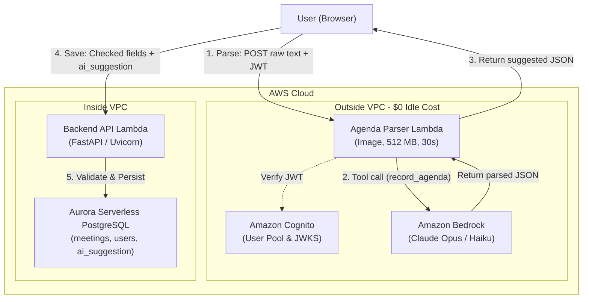

# ADR 0006: LLM Agenda Parsing with Amazon Bedrock

## Status
Accepted

## Context
Meeting agendas rarely originate as structured forms with predefined fields. In practice, they arrive as unstructured natural language text: manager emails, Slack/Teams chat messages, or hasty notes containing relative dates (e.g., "Monday 10:00", "by Friday"), topics, time allocations, speaker assignments, and follow-up action items.

To streamline meeting creation, the application introduces the **"Paste an agenda"** capability: a user pastes arbitrary unstructured text into the meeting modal, an LLM parses it into a strongly validated structured agenda, the form is prefilled with "Suggested" visual badges, and the human organizer reviews, edits, and explicitly commits the changes.

### Key Constraints:
1. **Zero Fixed Idle Cost ($0/month):** In accordance with the project's serverless architecture, components should incur zero fixed recurring costs when inactive. Deploying a NAT Gateway (~$32.85/month) or permanent VPC interface endpoints (~$7.30/month each) violates this principle.
2. **Untrusted External Input & Security:** Raw text from arbitrary emails or chat messages is untrusted and may contain malicious prompt injections, system override attempts, or excessive payloads.
3. **Auditability & Quality Signal:** The system must record cost, token metrics, and user corrections (the diff between AI suggestion and human save) to benchmark prompt iterations.

---

## Decision

### 1. Model Selection
We select **Claude through Amazon Bedrock** (defaulting to `anthropic.claude-opus-5-5` / `anthropic.claude-haiku-5-5`, with cross-model support for `us.amazon.nova-micro-v1:0` via Converse API). Claude offers exceptional multi-lingual comprehension (including Ukrainian and colloquial English), precise JSON schema extraction through tool calling (`record_agenda`), and rigorous adherence to negative constraints ("never invent values").

### 2. Execution Outside the VPC
The agenda parser Lambda (`AgendaParserFunction`) is deployed **outside the VPC**:
- The parser does not need database access; its only responsibility is `text -> JSON`.
- Operating outside the VPC gives the Lambda direct internet egress to AWS Bedrock endpoints over public TLS.
- This preserves the **$0/month idle cost** without requiring a VPC NAT Gateway or Bedrock Interface VPC Endpoints.

### 3. Model Never Writes (Decoupled Suggestion vs. Mutation)
**The LLM never writes to the database.**
- The parsing endpoint returns data strictly as suggestions to the client browser.
- The user reviews pre-filled fields (highlighted with visual "Suggested" badges).
- Saving proceeds solely through the trusted backend API (`POST /api/meetings` or `PUT /api/meetings/{id}`) inside the VPC, backed by standard Pydantic schema validation, ownership checks, and relational integrity.
- The original suggestion, model ID, and prompt version are stored alongside the meeting in `meetings.ai_suggestion` (JSONB) as an organic quality signal.

### 4. Public Lambda Function URL with Cognito JWT Authentication
Instead of routing parse requests through the VPC backend or setting up an expensive API Gateway, we expose a public **AWS Lambda Function URL**:
- `AuthType: NONE` on the AWS infrastructure level, with authentication enforced in application code.
- The Lambda handler validates the Cognito ID token (`Authorization: Bearer <token>`) against Cognito's public JWKS.
- Built-in payload limit checks (rejecting `len(text) > 10,000` with HTTP 413) protect compute budget.

---

## C4 Container Diagram (Level 2)

---

## Alternatives Considered

1. **Calling Bedrock from the VPC Backend via VPC Interface Endpoint:**
   - *Why it lost:* A Bedrock VPC interface endpoint costs ~$7.30 per month ($0.01/hr + data processing fees) 24/7, even when zero meetings are created. A class project or low-traffic startup would pay ~$88/year for idle networking. Running the parser outside the VPC achieves $0 fixed idle cost.
2. **Calling Anthropic Claude API directly (outside AWS) instead of Bedrock:**
   - *Why it lost:* Requires maintaining separate Anthropic API keys and billing outside AWS, complicating IAM role management, unified AWS billing, and data perimeter governance. Amazon Bedrock operates within our existing AWS IAM security model.
3. **Plain Regular-Expression / Rule-Based Parser:**
   - *Why it lost:* Regex cannot handle free-form Ukrainian or English colloquial phrasing, implicit meeting titles, multi-speaker agenda distribution, relative date resolution ("next Tuesday after lunch"), or unstructured follow-up action items.

---

## Consequences

- **Cost per Parse:**
  - Claude Haiku 5.5: ~1,000 input + ~250 output tokens costs **~$0.0002** per parse.
  - Claude Opus 5.5: ~1,000 input + ~250 output tokens costs **~$0.009** per parse.
  - Zero fixed infrastructure cost when nobody parses.
- **Observability:**
  - Every parse emits a structured JSON log to CloudWatch (`/new-project/agenda-parser`):
    `{"event": "agenda_parsed", "user": "...", "model": "...", "prompt_version": "agenda-v1", "input_tokens": 1050, "output_tokens": 220, "latency_ms": 1840, "cost_usd": 0.00022}`.
- **Failure Resilience:**
  - If Amazon Bedrock is throttled or temporarily down, the user receives an informative warning. Because the parser is strictly a side helper, the core Spry application remains 100% functional: users can type their meeting agendas by hand and save them normally.
