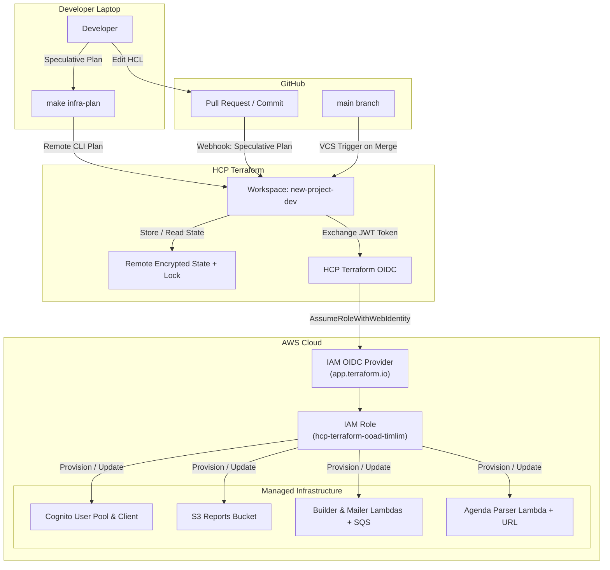

# ADR 0007: Migration from CloudFormation to Terraform & HCP Terraform (Terraform Cloud)

## Status
Accepted

## Context
In Labs 4, 5, and 6, infrastructure components were provisioned using AWS CloudFormation templates (`infra/auth.yaml`, `infra/reports.yaml`, `infra/ai.yaml`) deployed imperatively from local developer machines via shell wrapper scripts (`deploy-*.sh`) and long CLI flags.

While CloudFormation solved the basic need to define AWS resources as code, this workflow suffered from key collaborative and architectural limitations:
1. **Developer Machine Coupling & Lack of Locking:** Deployments ran from individual laptops. Two engineers running `make deploy-*` concurrently risked race conditions, conflicting parameter overrides, and uncoordinated state transitions.
2. **Local Credential Proliferation:** Every contributor required long-lived AWS IAM access keys stored locally in unversioned `.env` files.
3. **Multi-Stack Drift & Lack of Speculative Plans:** CloudFormation changesets are slow, tied strictly to AWS, and cannot preview dependencies or changes across decoupled stacks in a unified plan.
4. **Multi-Provider & Ecosystem Boundaries:** CloudFormation is fundamentally locked to AWS. Integrating non-AWS providers (such as Google Cloud, GitHub, Datadog, or external SaaS) is impractical.
5. **State & Lifecycle Inflexibility:** Adopting or un-managing resources in CloudFormation without recreation is cumbersome compared to modern declarative import blocks.

To establish a production-grade GitOps workflow, we migrate our auxiliary stacks (`auth`, `reports`, `ai`) to **Terraform (HCL)** managed remotely via **HCP Terraform (Terraform Cloud)** with zero downtime and zero data loss.

---

## Decision

### 1. Technology Selection: Terraform & HCP Terraform
We adopt **Terraform (v1.17+)** with **HCP Terraform** as the remote execution backend:
- **Why not CloudFormation?** CloudFormation is vendor-locked to AWS, lacks cross-provider support, has weak speculative preview tooling compared to `terraform plan`, and enforces heavyweight stack-level boundaries rather than composable modules.
- **Why not AWS CDK?** CDK synthesizes into CloudFormation, inheriting all CloudFormation runtime drawbacks. Furthermore, imperative programming languages (TypeScript/Python) for infrastructure often lead to hidden abstraction leakage, nondeterministic diffs, and complex compilation pipelines compared to declarative HCL.
- **Why not OpenTofu?** OpenTofu is a solid open-source fork, but HCP Terraform provides an enterprise-ready managed remote execution environment, seamless VCS pull-request plan previews, native dynamic OIDC authentication with AWS IAM, and centralized state locking out-of-the-box without maintaining self-hosted CI runners or S3/DynamoDB backends.

### 2. Remote State Management & Distributed Locking
All Terraform state is stored securely in **HCP Terraform Workspace** (`ooad-timlim / new-project-dev`):
- State locking is enforced automatically on all plan and apply operations, preventing concurrent conflicting executions.
- State is encrypted at rest (AES-256) and in transit (TLS 1.3).
- State versions are maintained with an audit log of who triggered each run.

### 3. Identity Federation (OIDC) & Least Privilege
We eliminate static AWS credentials from CI/CD and HCP Terraform:
- An **AWS IAM OpenID Connect (OIDC) Provider** is established for `https://app.terraform.io`.
- An IAM Role (`hcp-terraform-ooad-timlim`) is assumed dynamically by HCP Terraform during run execution via short-lived STS tokens (`TFC_AWS_PROVIDER_AUTH = true`).
- Local developer execution is limited to speculative plans (`terraform plan` via CLI-driven remote workflow) with read-only impact.

### 4. GitOps Workflow: Two Roads Architecture
We maintain a strict separation of concerns between Infrastructure as Code and Application Code:
- **Application Road (GitHub Actions):** Deploys application containers to existing Lambda and S3/CloudFront targets using the pipeline from Lab 2.
- **Infrastructure Road (HCP Terraform VCS Integration):**
  - Pull requests modifying `infra/**` trigger automatic speculative `terraform plan` checks visible directly in GitHub PR reviews.
  - Merging to `main` triggers an automatic `terraform apply` in HCP Terraform.
  - **No `terraform apply` is permitted from developer laptops or Makefiles.** The `Makefile` exposes only `make infra-plan`, `make infra-fmt`, and `make infra-validate`.

### 5. Safe Zero-Downtime Resource Adoption
Existing stateful resources (`Cognito User Pool`, `S3 Reports Bucket`, `Lambda Log Groups`, IAM roles) were safely transitioned from CloudFormation by:
1. Adding `DeletionPolicy: Retain` to CloudFormation templates.
2. Deleting CloudFormation stacks, leaving real resources intact.
3. Defining declarative `import {}` blocks in Terraform HCL.
4. Applying imports without modifying or recreating stateful data.

---

## Architecture

---

## Consequences

### Positive
- **Zero Local Secrets:** AWS IAM long-lived credentials are no longer needed on developer workstations for infrastructure provisioning.
- **Deterministic Previews:** Every pull request provides an exact preview of cloud modifications before changes land in `main`.
- **Concurrency Protection:** HCP Terraform distributed locks eliminate conflicting concurrent runs.
- **Multi-Cloud Extensibility:** The infrastructure codebase can now seamlessly incorporate non-AWS providers (e.g., Datadog, GitHub, Cloudflare, GCP) in the same HCL language and dependency graph.
- **Safe State Inspection:** State is centralized, encrypted, and versioned without risk of committing `terraform.tfstate` into Git.

### Trade-offs & Mitigations

#### 1. Who can change the infrastructure now, and how?
- Infrastructure changes can **only** be applied by merging reviewed pull requests into the default branch (`main`) of the GitHub repository.
- Developers can test changes locally by running `make infra-plan`, which performs a remote speculative plan in HCP Terraform against the real state, but cannot mutate real resources.

#### 2. Where do secrets end up (including state)?
- Sensitive variables (e.g., `google_client_secret`) are stored as **Sensitive Variables** in the HCP Terraform Workspace. They are write-only in the HCP UI and masked in all execution logs.
- Sensitive values evaluated into resource arguments (such as `client_secret` in Cognito IdP) are persisted inside the remote Terraform state file.
- **Mitigation:** The state file is encrypted at rest with AES-256 in HCP Terraform, accessible only to authenticated workspace administrators via RBAC and audited via audit logging. It is **never** committed to Git.

#### 3. What happens if HCP Terraform is down?
- **Existing infrastructure is completely unaffected:** Running AWS Lambda functions, Aurora databases, S3 buckets, and Cognito pools continue to operate normally with zero interruption (the control plane is decoupled from the data plane).
- **Emergency deployment bypass (Break-Glass):** If HCP Terraform experiences an extended outage and an urgent infrastructure change is required:
  1. The team can export the latest state snapshot using the HCP Terraform API / UI or authenticated CLI.
  2. Switch the `backend "cloud"` block in `versions.tf` to a temporary S3 backend (`backend "s3"`).
  3. Assume an administrative AWS IAM role directly and run `terraform plan` / `terraform apply` locally.
  4. Once HCP Terraform recovers, the state can be migrated back with `terraform init -migrate-state`.
